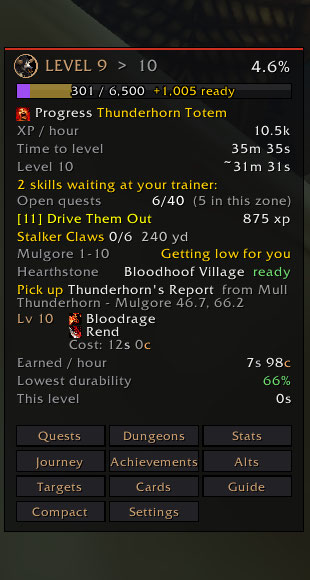
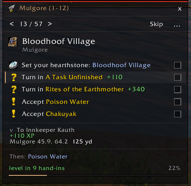
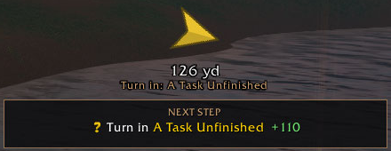
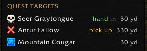
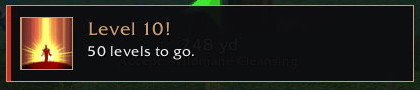
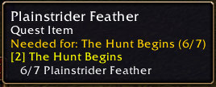

# Hearthbound

A levelling companion addon for WoW Forever (Interface 16001). Hearthbound
brings a step-by-step Horde 1-60 guide, an XP panel and a set of quality-of-life
tools into one window, and keeps a record of each character's journey to 60.

## Screenshots

| Levelling panel | Guide step |
| --- | --- |
|  |  |

| Guide arrow and next step | Quest targets |
| --- | --- |
|  |  |

| Milestone pop-up | Quest item tooltip |
| --- | --- |
|  |  |

## Features

**Levelling guide**
- Walks the Horde 1-60 route one step at a time. Steps tick off as you accept,
  finish and hand in quests, reach a spot, fly, set your hearth, train or enter a dungeon
- Movable arrow with distance to the next step, numbered map pins, and a quest
  item button for steps that need an item used
- Says when your hearthstone would get you to the next step sooner, and by how
  many minutes
- Detours, "on the way" quests near your route, quest log tidy-up, and a guide
  that learns from your play
- Guide panel with every zone and section of the route
- Quests that are new in WoW Forever are marked NEW, and each zone shows how many it has
- Dungeon runs built into the route: it picks up a dungeon's quests as you pass
  their givers, sends you in at the right level, then hands them in. Leave out
  any dungeon (right-click its step, or on its page), or all of them in Settings
- Party sync: party members who have Hearthbound see each other's step, and the
  party leader can bring everyone to the leader's step (`/hb guide sync`).
  Members are asked first, or can choose to follow the leader without asking

**Built around your character**
- Recognises your class and spec: the talent tree with the most points, or the
  one you choose with `/hb spec`, for all nine classes
- Quest rewards scored for your spec, leaving out armour and weapons you can't use
- Reminds you of your class's quest chains as they open, like druid forms, hunter
  pets, warlock demons, shaman totems, rogue poisons and mage teleports
- Warns about what your class runs on: drink, arrows and bullets, soul shards,
  reagents and a hungry pet
- Class achievements for every class

**Levelling panel**
- XP bar, XP/hour and time-to-level, plus a restyled game XP bar
- Road to 60: forecasts play time needed for each milestone level
- Objectives nearby, quests ready to hand in, best XP quests, grind spots and
  "where next" zone suggestions
- Trainer reminders, talent points, weapon skills and class quests
- Gold tracker, repair warning, food supplies and session goals (`/hb goal 30`)

**Quests**
- Auto accept / auto hand-in (toggleable per type) and a quest reward picker
- Quest pins on the world map and minimap, mob tooltips showing quest progress,
  a quest targets window, and "(Completed)" tags on chat quest links
- Quest item keep/sell tooltips and a vendor helper that sells greys
- "Don't leave yet" alert when you walk away from quests you could finish
- Completed quest history and a Secrets view of hidden quests, toys, pets and
  collections

**Dungeons**
- Dungeon journal with every quest for your character: who gives it, where (with
  a map marker), what to do first, and which start inside. Plus bosses, per-boss
  loot and a banner picture for each dungeon

**Journey and stats**
- Journey tab: road to 60, milestones reached, deaths and level history
- Stats tab: session summary, XP sources, best mobs, kills by creature type
- Achievements, milestone pop-ups and level-up screenshots
- Enemy card collection: each different enemy you kill adds its card
- Alts tab with an account-wide snapshot of every character and total gold

**Interface**
- One shell window with a tab rail, menu column and content panel
- Optional Hearthbound-styled nameplates with threat colours
- Minimap button, welcome-back summary on login, first-time setup wizard
- A "What's new" window once after each update, with links to new settings (`/hb new`)
- Settings profiles (export / import as text) and a debug report

## Installation

1. Open the [latest release](https://github.com/danw1986/wow-forever-hearthbound/releases/latest)
   and download `Hearthbound-<version>.zip` (not "Source code").
2. Unzip it into:

   ```
   World of Warcraft\_forever_\Interface\AddOns\
   ```

   You should end up with `AddOns\Hearthbound\Hearthbound.toc`.
3. Restart the game, or `/reload` if you're updating.

## Commands

| Command | Does |
| --- | --- |
| `/hb` | Open settings |
| `/hb help` | List all commands |
| `/hb setup` | Run first-time setup again |
| `/hb spec` / `spec <name>` / `spec auto` | Show your spec, choose one, or go by your talents |
| `/hb guide ...` | Levelling guide commands |
| `/hb quests` / `stats` / `journey` / `alts` / `dungeons` / `achievements` | Open that tab |
| `/hb cards` | Enemy card collection |
| `/hb targets` | Quest targets window |
| `/hb goal <level>` | Set a session goal |
| `/hb left` / `left <n>` / `left clear` | Quests you walked away from |
| `/hb accept` | Toggle auto accept |
| `/hb summary` / `last` | This session's / last session's summary |
| `/hb lock` / `unlock` / `reset` | Lock, unlock or reset frame positions |
| `/hb xpreset` | Reset the XP session |
| `/hb export` / `import` | Settings profiles as text |
| `/hb plates test` | Cycle threat colours on your target's nameplate |
| `/hb debug` / `mem` | Debug report / memory usage |

Key bindings for the guide (Next, Back, Current, Find, Arrow, Toggle) are under
Key Bindings > AddOns > Hearthbound.

## Saved data backup

The WoW Forever beta client saves addon data on exit but doesn't always read it
back. To work around this:

1. Close the game.
2. Double-click `Backup Hearthbound.bat`.

The script copies the saved variables into a timestamped `Backups` folder
(keeping the latest 15) and writes them into `Seed.lua`, which the addon loads
on the next login. It also picks up any dungeon pictures dropped into
`Images\Incoming` (see the readme there for file names).

## Repository layout

| Path | Contents |
| --- | --- |
| `*.lua`, `Hearthbound.toc`, `Bindings.xml` | The addon |
| `GuideData.lua` | The levelling route |
| `Images/`, `Media/` | Dungeon pictures, card art and textures |
| `screenshots/` | README screenshots |
| `ClassData.lua` | Each class's specs, stat weights, quest chains and talent plans |
| `Tests/` | Offline test harness (Lua mocks + Python test and route tools) |
| `Tests/build_release.py` | Builds the zip attached to a release |
| `RouteBackups/` | Earlier snapshots of files from past reworks |

## Licence

GPL-3.0: see [LICENSE](LICENSE). The dungeon pictures in `Images/` are third-party
images and aren't covered by this licence.

## Version

0.9.6
